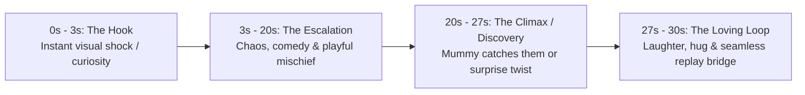

# 📖 Viral Story Scripting Skill — 3D Kids Animation

A structured creative guide for scripting high-retention 30-second vertical 3D animated comedy and nursery rhyme Shorts.

---

## 🎭 Character Bible & Personalities

### 1. Kaartik (4-Year-Old Boy)
- **Role**: Energetic, curious, mischievous leader, loves adventure and snacks.
- **Visuals**: Spiky brown hair, yellow t-shirt with blue dino print, denim shorts.
- **Voice / Delivery**: Fast-paced, enthusiastic, giggly, speaks Hindi with toddler innocence.
- **Catchphrase / Tropes**: "अरे दीदी देखो!", "आहाहा मज़ा आ गया!"

### 2. Kaavya (2.5-Year-Old Baby Girl)
- **Role**: Adorable, cheeky copycat, expressive wide eyes, loves bright colors and giggles.
- **Visuals**: Two cute high ponytails with red ribbons, pink floral frock or dungarees.
- **Voice / Delivery**: Sweet baby voice, cute laughs, repeats brother's mischievous ideas.
- **Catchphrase / Tropes**: "भैया देखो!", "हीहीही!"

### 3. Mummy
- **Role**: Warm, loving Indian mother, playful disciplinarian who ends every chaos with hugs and smiles.

---

## ⏱️ The 30-Second 3-Act Retention Formula

1. **Act 1: The Hook (0s – 3s)**
   - Start mid-action. No introductions or fades.
   - Example: Kaavya holding Mummy's red lipstick like a crayon, smiling mischievously at the mirror.

2. **Act 2: The Escalation (3s – 20s)**
   - Pacing: 3–4 dynamic camera cuts (close-up of lipstick drawing a big bindi, Kaartik drawing moustache on himself, both bursting into laughter).
   - Sound FX: Squeaky crayon sounds, toddler giggles, funny "boing" accents.

3. **Act 3: The Loving Climax & Replay Hook (20s – 30s)**
   - Mummy enters with hands on hips, gasps, and then bursts out laughing and hugs both of them.
   - Final line loops back into the excitement of the next Short.
