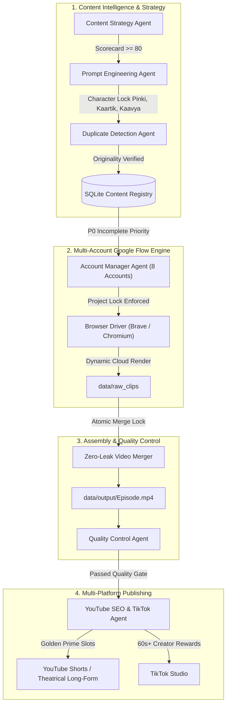

# Autonomous 3D Animation Studio — Pixar-Style Content Factory

[](https://www.python.org/downloads/)
[](https://opensource.org/licenses/MIT)
[](https://github.com/psf/black)
[]()

Production-grade, modular, self-healing autonomous AI content automation studio engineered for **The Naughty Duo** brand. End-to-end autonomous pipeline featuring 9:16 Reference 3D Image Anchoring (I2V), multi-account **Google Flow** orchestration, cute toddler Hindi dialogues, 100% original natural audio preservation, and automated multi-platform publishing to **YouTube Shorts** and **TikTok Studio**.

## 🤖 Social Media Agent Team

This project now includes a daily social-media agent team that coordinates research, scripting, editing, publication validation, and analytics for YouTube and TikTok. It is built as a safe, policy-aware starter layer on top of the existing production engine.

Run a single daily cycle:

```bash
python scripts/run_daily_social_media_cycle.py --max-videos 3
```

Live publishing is disabled by default. Do not enable it until the operator has reviewed the batch, all video assets pass QA, and platform credentials have been validated:

```bash
python scripts/run_daily_social_media_cycle.py --max-videos 3 --live --no-dry-run
```

To run a persisted daily plan that stores the generated queue to `data/daily_social_media_plan.json`:

```bash
python scripts/daily_social_media_scheduler.py --max-videos 3
```

To safely prepare and dispatch a live batch only when output files already exist:

```bash
python scripts/live_content_dispatch.py --max-videos 3 --live --no-dry-run
```

The team uses the existing config in `config/config.json`, rotates across active Google Flow accounts, and stays in safe dry-run mode by default so it never uploads without explicit live approval.

### Use Brave while Flow automation runs

The Flow browser worker uses a dedicated persistent profile per account at `browser_sessions/flow_slot_<slot>`, separate from your everyday Brave profile. It no longer removes browser profile lock files. This lets you keep using your regular Brave window while a worker uses its isolated profile.

Before using a slot for the first time, open that dedicated profile and sign into the matching Google account:

```powershell
python scripts/open_flow_automation_profile.py --slot 0
```

Use the configured account for that slot, then close the dedicated window before running automation for that slot. Repeat for each account slot you intend to automate. Keep your normal Brave window separate; do not point `BRAVE_EXECUTABLE` or automation profile paths at your everyday Brave `User Data` directory. The profiles are persistent and contain account sessions, so do not share or commit `browser_sessions`.

### Full-stack launch command

To launch the full autonomous system and operator dashboard together:

```bash
python scripts/run_full_social_media_suite.py --max-videos 3
```

This starts the local control center on `http://127.0.0.1:8088`, runs a daily batch plan in dry-run mode, and prints the batch health and publishing gate. Dry-run is not an upload and must not be treated as published content.

See [FINAL_RUNBOOK.md](./FINAL_RUNBOOK.md) for the frozen release workflow, safe commands, job states, live prerequisites, and limitations. The current project is a release candidate, not a guarantee of viral reach or production-ready platform authentication.

### Viral growth stack

The default production workflow now includes a second layer of viral-growth agents:

- `TrendResearchAgent`: picks the strongest hook patterns for YouTube Shorts and TikTok.
- `ThumbnailEngineerAgent`: optimizes first-frame attention, color contrast, and headline clarity.
- `PerformanceAnalyticsAgent`: evaluates watch time, retention, CTR, and recommends what to double down on.
- `ComplianceGuardAgent`: makes sure CTA, title, and platform rules remain safe.
- `LocalOpsDashboardAgent`: shows which agent is active and whether the batch is healthy enough to publish.

This keeps the system aligned with the real viral formula:

1. 0–2 second visual hook
2. single idea, no slow setup
3. emotional reaction before logic/explanation
4. strong payoff in the first third
5. CTA pinned in the last 2–3 seconds
6. consistent publishing in the best platform windows for retention

## 🎬 Google Flow Generation Agent

The repo now includes a specialized `GoogleFlowGenerationAgent` that builds locked prompt packs for multi-scene short-form videos. It enforces:

- exact character identity for Kaavya, Kaartik, and Pinki
- fixed room layout and placement rules
- safe 9:16 vertical generation guidance
- no forbidden deep-water or dangerous framing
- exact scene ordering for 8-scene Shorts/ TikTok storytelling
- final LIKE + SUBSCRIBE CTA in the last scene

You can use it directly from Python:

```python
from agents.google_flow.google_flow_agent import GoogleFlowGenerationAgent

agent = GoogleFlowGenerationAgent()
pack = agent.build_default_waterpark_story()
print(pack["scene_sequence"][0]["prompt"])
```

## 🔒 Permanent Character Benchmark & Face Lock System
To completely eliminate character inconsistency and facial drift across long multi-clip stories, this engine enforces a **Disk-Level Face Lock Protocol**:
- **Master Reference Assets (`character_master_bible/`):** High-resolution cropped face anchors for all primary characters:
  - `kaartik_face_anchor.jpg` (5yo Boy: glossy hazel doe eyes, dark wavy hair tuft with messy side-swoop, chubby dimpled cheeks).
  - `kaavya_face_anchor.jpg` (3yo Toddler: signature **Double High Space Buns** with cute floral ties, rosy cherub cheeks, doe eyes).
  - `mummy_face_anchor.jpg` (Young Indian Mother: warm almond eyes, voluminous wavy espresso hair, radiant smile).
- **Zero-Drift Continuity Policy:** Every generation chain begins from canonical face anchors or the preceding clip's exact uncompressed end-frame.

## 🛡️ Master Upload Registry Gate (Instant Zero-Waste Verification)
Never waste credits or audience retention on duplicate uploads:
- **Registry Database (`channel_master_upload_registry.json`):** Tracks every generated episode, platform publish status (YouTube Shorts & TikTok), view counts, and video IDs.
- **Instant Pre-Upload Gate (`verify_before_upload.py`):**
  ```bash
  python verify_before_upload.py <video_filename_or_keyword>
  ```
  Runs in **0.01 seconds** without opening browsers or consuming API quota. If the video is already live on YouTube or TikTok, the pipeline immediately halts and prevents duplicate publication.

## 🎬 Single Continuous Movie Illusion (1.3 to 2.5 Minutes)
- Multi-clip episodes (78s to 150s) are seamlessly stitched with sub-second crossfades and continuous forward narrative motion.
- **Zero Repetition Rule:** Zero looping, zero repeated actions. Every second delivers fresh comedy, emotion, or story progression.

---

## 📑 Table of Contents
1. [Core Architectural Principles](#-core-architectural-principles)
2. [Permanent Character Lock System](#-permanent-character-lock-system)
3. [8 Google Flow Account Orchestration](#-8-google-flow-account-orchestration)
4. [Strict Project Locking Policy](#-strict-project-locking-policy)
5. [Critical Incomplete Story Recovery (P0 State Machine)](#-critical-incomplete-story-recovery-p0-state-machine)
6. [Windows Startup Duplicate Protection](#-windows-startup-duplicate-protection)
7. [System Architecture Diagram](#-system-architecture-diagram)
8. [Quickstart & Installation (Beginner-Friendly)](#-quickstart--installation-beginner-friendly)
9. [Local Control Center Dashboard](#-local-control-center-dashboard)
10. [Security & Multi-Account Isolation](#-security--multi-account-isolation)
11. [Testing & Simulation Mode](#-testing--simulation-mode)
12. [Troubleshooting & Self-Healing Hierarchy](#-troubleshooting--self-healing-hierarchy)

---

## 🎯 Core Architectural Principles

Unlike basic single-file scripts that loop blindly, this platform functions as a **distributed digital content studio**:

- **Safety & Policy Compliance First:** Strict COPPA Made-For-Kids declaration and anti-repetition protection.
- **Original Content Only:** Identifies pacing, rhythm, visual clarity, and emotional beats from successful global children's content patterns (e.g. Cocomelon) without copying characters, melodies, or creative expression.
- **Evidence-Based Optimization:** No fake AI virality claims. Optimizes for real retention metrics (0-3s visual hook, 60s completion rate, rewatch loops).
- **Zero-Waste Memory Management:** Automatic subprocess cleanup preventing GPU/DWM memory leaks or black-screen freezes.

---

## 🔒 Permanent Character Lock System

The platform strictly locks the identity of the three official characters across all generations:

| Character | Role | Age | Locked Visual Identity | Locked Clothing | Voice Style |
| :--- | :--- | :--- | :--- | :--- | :--- |
| **Pinki** | Mom | 25 | Warm expressive eyes, dark wavy styled hair, loving Indian mother | Powder-blue traditional Indian kurti, silver stud earrings | Melodious, loving Hindi mother voice |
| **Kaartik** | Son | 5 | Energetic boy, big curious eyes, neat parted dark hair | Bright mustard-yellow polo shirt, dark blue shorts, sporty sneakers | Excited, cheerful Hindi toddler voice |
| **Kaavya** | Daughter | 3 | Adorable toddler girl, sparkling innocent eyes, chubby rosy cheeks | Soft baby-pink polka-dot dress, twin pigtails with pink ribbons | Sweet, innocent Hindi toddler giggle |

> **Quality Benchmark:** All visual scenes strictly match the approved **"Garden Me Jhula (High-Fidelity 3D Pixar)"** cinematic warm lighting and rendering benchmark.

---

## 🔄 Google Flow Account and Quota Handling

Production generation uses one configured account (`google_flow.production_slot`, default `0`) and one isolated Brave profile at a time. When that account reaches its credit or quota limit, generation pauses and leaves the scene queued for a later run after the quota resets. It does not rotate through accounts to bypass per-account free-credit limits. Simulation tests may still use multiple workers.

---

## 🛡️ Strict Project Locking Policy

When Google Flow opens:
1. Navigates directly to the account session (`https://flow.google.com/u/{slot_index}/`).
2. Opens the configured Project ID or searches for the configured Project Name.
3. Continues generation **strictly inside that existing project**.
4. **NEVER silently clicks `+ New Project`** to avoid polluting accounts with duplicate blank projects. If a project is missing, it halts safely and logs an alert.

---

## 🚨 Critical Incomplete Story Recovery (P0 State Machine)

If Windows restarts, the browser crashes, or credits run out after Part 1 is generated:
1. The story is marked persistently in SQLite as `PARTIAL` with **Priority P0**.
2. Completed raw clips are saved and checksummed in the global registry.
3. When credits or accounts become available, the system **prioritizes finishing this incomplete story before touching any new content**.
4. Previously completed parts are never re-rendered.

---

## ⚡ Windows Startup Duplicate Protection

On Windows boot:
1. Loads SQLite database (`data/content_engine.db`).
2. Checks the content fingerprint registry.
3. Verifies whether any job was interrupted.
4. Resumes existing jobs seamlessly.
5. **DOES NOT start generating duplicate copies of existing stories.**

---

## 📐 System Architecture Diagram



---

## 🚀 Quickstart & Installation (Beginner-Friendly)

### Step 1: Clone the Repository
```bash
git clone https://github.com/Abhiv46/autonomous-3d-animation-studio.git
cd autonomous-3d-animation-studio
```

### Step 2: Install Python Dependencies
```bash
python -m pip install -r requirements.txt
playwright install chromium
```

### Step 3: Configure Environment
Copy `.env.example` to `.env` and fill in your settings:
```bash
copy .env.example .env
```

### Step 4: Configure Master Accounts & Project IDs
Edit `config/master_config.example.json` with your 8 Google Flow project IDs and YouTube Channel ID.

### Step 5: Launch the Control Center
Double-click `START_CONTROL_CENTER.bat` or run:
```bash
python scripts/safe_startup_runner.py
```
Open your browser to: **`http://127.0.0.1:8088`**

---

## 📊 Local Control Center Dashboard

The local web dashboard provides complete real-time observability:
- **System Status:** Content Engine, Google Flow, YouTube API, TikTok status.
- **Account Health:** Live credit levels and project lock status across all 8 accounts.
- **Queue Monitor:** Visual status of P0 Incomplete recoveries vs scheduled new releases.
- **One-Click Actions:** Run Simulation, Pause Automation, Force Incomplete Story Recovery.

---

## 🔐 Security & Multi-Account Isolation

- **Zero Secrets in Code:** Passwords, API tokens, and session cookies are never hardcoded.
- **Multi-Account Channel Mismatch Guard:** YouTube adapter verifies target channel ID before every upload. If mismatched, the upload is immediately aborted.
- **Human Approval Firewall:** Sensitive actions (financial transactions, billing, permanent deletions) require human confirmation.

---

## 🧪 Testing & Simulation Mode

Run the complete automated test suite:
```bash
pytest tests/test_core_operations.py -v
```

Enable simulation mode without burning credits:
```bash
# In .env
SIMULATION=true
```

---

## 🛠️ Troubleshooting & Self-Healing Hierarchy

1. **Browser Profile Locked:** Run `python -c "from core.concurrency import ProcessManager; ProcessManager.cleanup_orphaned_browser()"` to release locks.
2. **RAM High / Screen Blackout:** The system includes an automatic subprocess reaper that prevents runaway `ffmpeg` instances.
3. **Google Flow Project Not Found:** Check that your Project ID matches in `config/master_config.example.json`. The engine will halt safely rather than creating duplicate projects.

---

## 📄 License
Licensed under the [MIT License](LICENSE).
